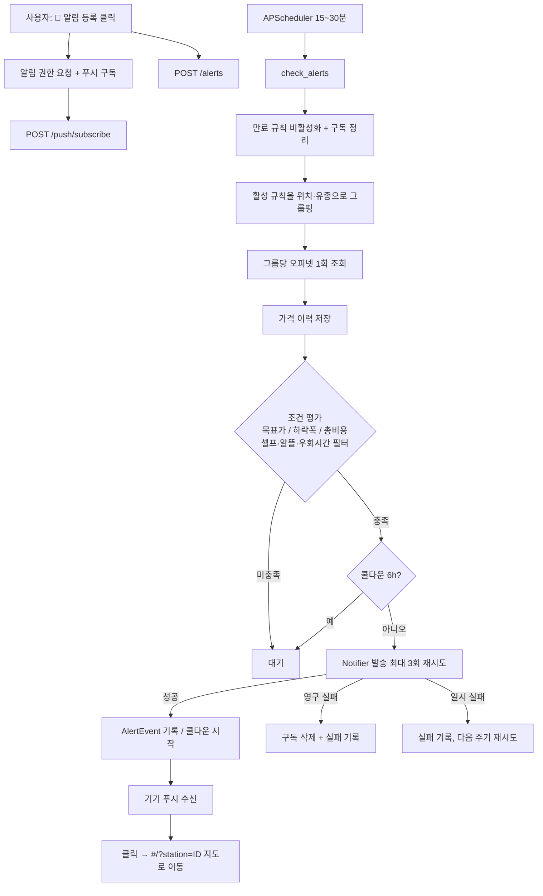

# 제주 렌터카 주유 최저가 도우미 + 가격 알림

제주 렌터카 반납 전, **기름값 + 이동 시간**을 함께 따져 가장 이득인 주유소를 추천하고, 목표 가격이 되면 푸시 알림을 보내는 PWA 웹앱입니다.

- 백엔드: FastAPI · SQLModel(SQLite) · APScheduler · pyproj
- 프론트엔드: React + Vite (모바일 우선, Leaflet 지도), PWA(manifest + service worker + 웹 푸시)
- 회원가입 없음: 브라우저가 만든 익명 `device_token`(헤더 `X-Device-Token`)으로 동작

```
총비용 = (리터당 가격 × 주유량) + (우회 소요시간(분) / 60 × 시간 가치) + 이동(왕복/우회) 연료비
```

## 1. 실행 방법

### 로컬 (가장 빠른 확인: MOCK 모드)

```bash
cp .env.example .env            # MOCK=true 가 기본값
cd backend
python -m venv .venv && source .venv/bin/activate   # Windows: .venv\Scripts\activate
pip install -r requirements.txt
uvicorn main:app --reload --port 8000
```

```bash
cd frontend
npm install
npm run dev                      # http://localhost:5173  (API는 :8000 으로 프록시)
```

- API 문서: http://localhost:8000/docs
- 서비스 워커/푸시는 **프로덕션 빌드**(`npm run build`)에서만 등록됩니다. 웹 푸시는 HTTPS(또는 localhost)가 필요합니다.

### Docker

```bash
cp .env.example .env
docker compose up --build        # http://localhost:8000 (프론트+API 함께 서빙, DB는 volume)
```

## 2. API 키 발급처

| 용도 | 발급처 | 환경변수 |
| --- | --- | --- |
| 주유소/가격 | 오피넷 무료 API — https://www.opinet.co.kr/user/custapi/openApiInfo.do (신청 후 승인) | `OPINET_API_KEY` |
| 이동 시간 | 카카오 Developers — https://developers.kakao.com → 앱 생성 → REST API 키 (카카오모빌리티 길찾기 사용 설정 필요) | `KAKAO_REST_API_KEY` |

- 카카오 키가 없거나 호출이 실패하면 **직선거리 기반 추정치**로 자동 대체되고 화면에 "(추정)"으로 표시됩니다.
- 오피넷 `aroundAll.do` 반경 상한은 5km입니다. 6~10km 요청은 중심 + 동서남북 5km 지점 5곳을 조회해 병합합니다(오피넷 호출이 늘어납니다).
- 오피넷 상세 응답에서 셀프 여부는 `SELF_YN` 계열 필드 또는 상호명("셀프")으로 판별하는 **휴리스틱**입니다. 실제 응답 필드를 확인해 `stations/prices.py::_parse_detail` 을 조정하세요.

## 3. VAPID 키 생성 (웹 푸시)

```bash
pip install py-vapid
vapid --gen                       # private_key.pem / public_key.pem 생성
vapid --applicationServerKey      # 브라우저용 공개키(base64url) 출력
```

- `VAPID_PUBLIC_KEY` = 위 `Application Server Key` 값
- `VAPID_PRIVATE_KEY` = `private_key.pem` 경로 또는 PEM 내용(pywebpush가 허용하는 형식)
- `VAPID_SUBJECT` = `mailto:본인이메일`

## 4. 환경변수 (`.env.example` 기준)

| 변수 | 설명 | 기본값 |
| --- | --- | --- |
| `MOCK` | true면 외부 API 없이 샘플 데이터 + 콘솔 알림 | `true`(예시) / 코드 기본 `false` |
| `OPINET_API_KEY`, `KAKAO_REST_API_KEY` | 외부 API 키 | 빈 값 |
| `DATABASE_URL` | SQLite 경로 | `sqlite:///./jeju_gas.db` |
| `CORS_ORIGINS` | 쉼표 구분 허용 오리진 | `http://localhost:5173` |
| `FRONTEND_DIST` | 존재하면 백엔드가 `/` 에서 정적 서빙 | `../frontend/dist` |
| `PRICE_CACHE_TTL_SECONDS` | 주유소 상세 캐시(5~10분) | `420` |
| `TRAVEL_CACHE_TTL_SECONDS` | 길찾기 캐시 | `600` |
| `SCHEDULER_ENABLED` | 스케줄러 사용 | `true` |
| `ALERT_CHECK_INTERVAL_MINUTES` | 알림 검사 주기 | `20` |
| `ALERT_BATCH_SIZE` / `ALERT_BATCH_DELAY_SECONDS` | 한 사이클 처리 그룹 수 / 그룹 간 대기 | `50` / `0.3` |
| `NOTIFY_MAX_ATTEMPTS` | 발송 재시도 횟수 | `3` |
| `VAPID_*` | 웹 푸시 키 | 빈 값 |
| `SMTP_*` | 이메일 알림(선택) | 빈 값 |

## 5. 스케줄러 주기 설정

`.env` 의 `ALERT_CHECK_INTERVAL_MINUTES` (15~30 권장)를 바꾸고 서버를 재시작합니다. 앱 시작 시 자동으로 시작되고 종료 시 정리됩니다. 사이클마다 ① 대여 기간 만료 정리 ② 알림 검사 ③ 반납 D-1/D-day 요약 ④ 14일 지난 가격 이력 삭제를 수행하며, 실패하면 로그만 남기고 다음 주기에 재시도합니다. 끄려면 `SCHEDULER_ENABLED=false`.

## 6. 알림 흐름



알림 채널은 `alerts/notifier.py` 의 `Notifier` 를 상속해 추가합니다(카카오 알림톡 등) — `build_notifier()` 에 등록하면 `MultiNotifier` 가 묶어서 보냅니다.

## 7. MOCK 모드 테스트

1. `.env` 에 `MOCK=true`, `ALERT_CHECK_INTERVAL_MINUTES=1` 로 두고 서버 실행.
2. 프론트에서 주유소를 눌러 “🔔 이 가격에 알림”을 등록(목표가를 현재가보다 조금 높게).
3. 가짜 가격은 10분 단위로 변하는 파동 + 드리프트입니다. 조건을 만족하면 서버 콘솔에 `[MOCK 알림] ...` 이 출력되고 알림 카드의 “발송 이력”에서도 확인됩니다. “테스트” 버튼은 즉시 1건을 보냅니다.
4. 자동 테스트: 루트에서 `pip install -r backend/requirements.txt && pytest`.

## 개인정보 / 안정성

- 위치는 소수점 3자리(~110m)로 반올림해 저장합니다. 계정 없이 `device_token` 기반이며 추후 계정 연동이 가능한 구조입니다.
- 푸시 구독/VAPID/SMTP 비밀값은 모두 `.env`. 코드에 키를 넣지 않습니다.
- 대여 종료일(KST 24시)이 지나면 규칙을 자동 비활성화하고, 활성 규칙이 없는 기기의 푸시 구독을 삭제합니다.
- 발송 실패는 최대 3회 재시도, 구독 만료(404/410)는 즉시 구독 삭제. 외부 API 오류는 한국어 메시지로 안내합니다.
- 전기차는 이번 범위 밖이지만 `FUEL_TYPES` 와 `GasStation` 모델에 충전소 항목을 추가하는 방식으로 확장할 수 있습니다.

## 프로젝트 구조

```
jeju-gas/
├── backend/ (main, config, database, stations/*, alerts/*)
├── frontend/ (public/manifest.json, sw.js, src/pages|components|hooks)
├── tests/ (pytest)
├── .env.example · Dockerfile · docker-compose.yml
```
